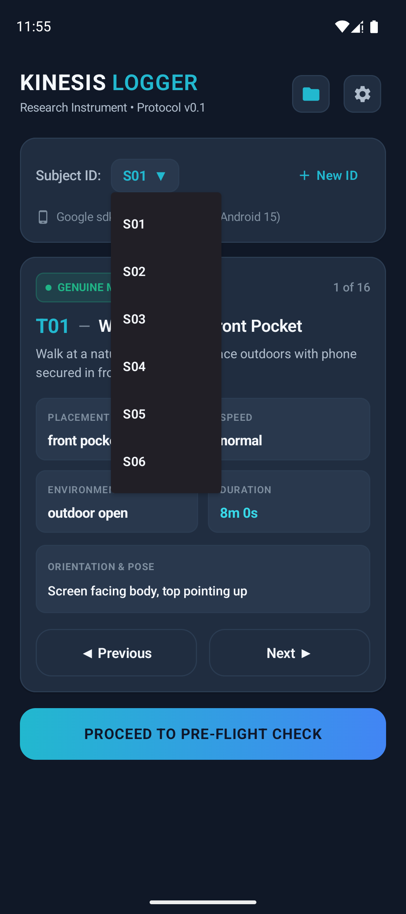
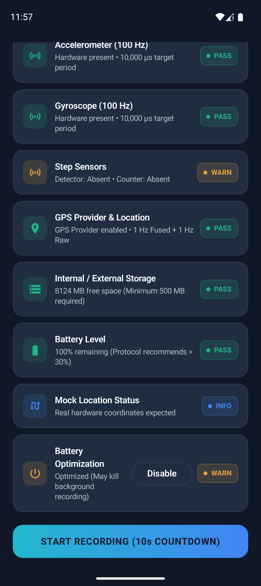
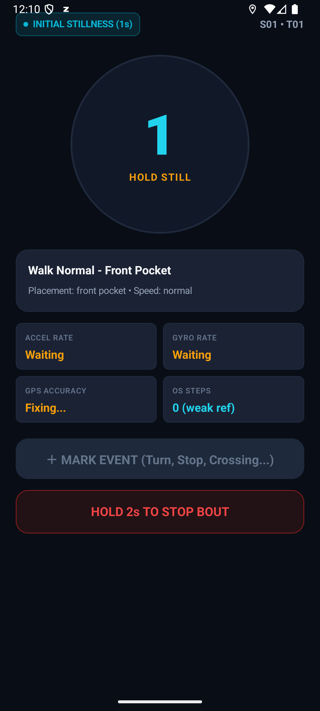
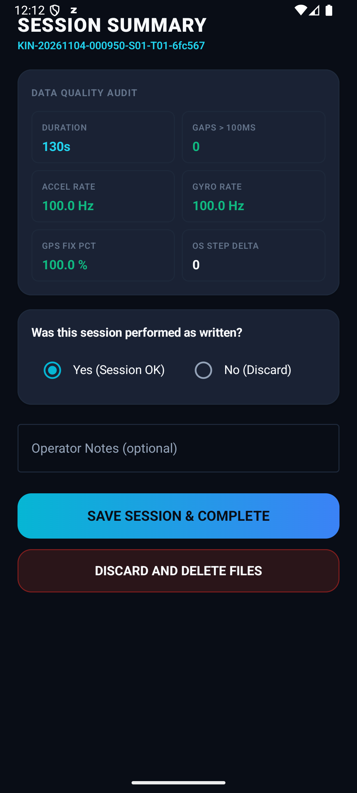
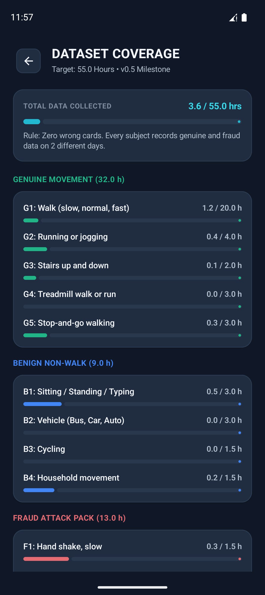
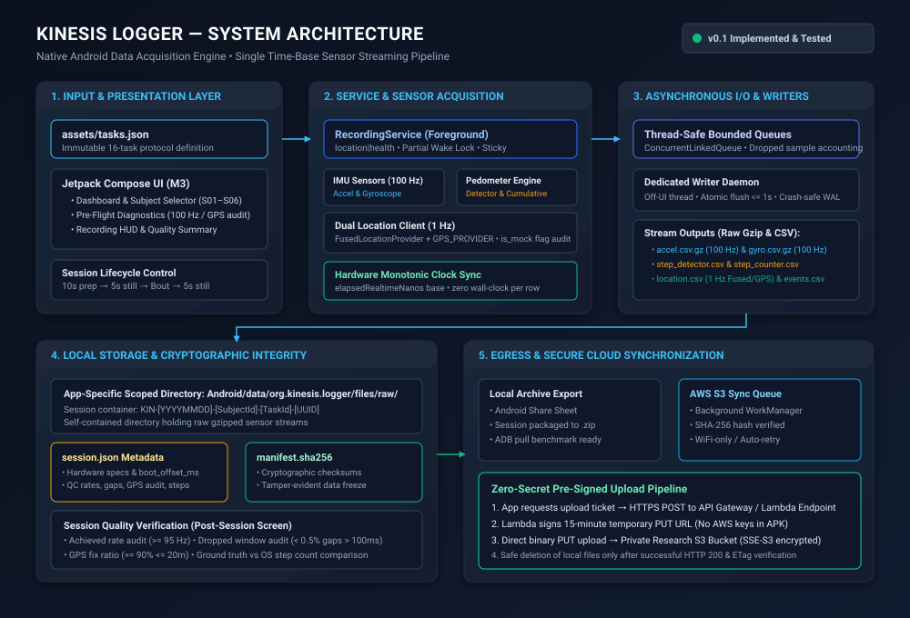
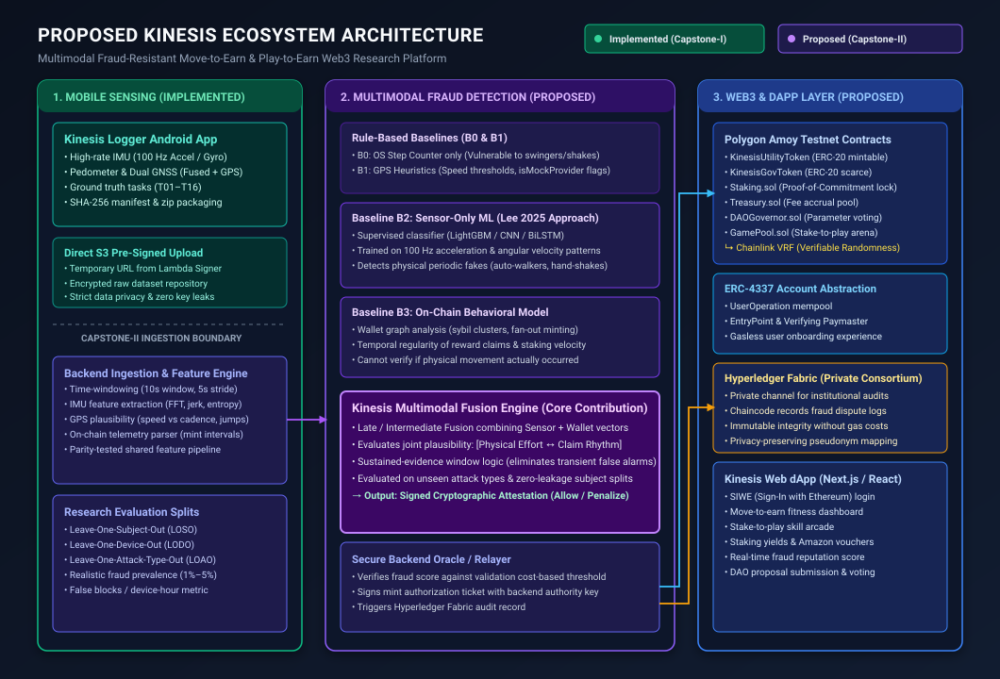

# Kinesis Logger (v0.1)

A native Android data-acquisition instrument built for the **Kinesis** research project (Capstone-I / II, by P Samuel Vijay and Arikela Sriharsh; Faculty Guide: P Phani Prasad, Dept. of CSE – Allied, MVSR Engineering College).

Kinesis Logger records time-aligned, un-resampled raw sensor streams (100 Hz accelerometer, 100 Hz gyroscope, step detector, step counter, 1 Hz fused GNSS, and 1 Hz GPS provider) across structured genuine movement, everyday benign non-walking, and physical fraud attacks.

---

### Project Context

> **Kinesis Logger is a dedicated Android data-collection application developed as one component of the broader [Main Kinesis Project](https://github.com/psamuelvijay/Kinesis).** Its role is to capture, organize, and export the mobile sensor and location data required for the research and development of the larger system. It serves as the data-acquisition layer, while the main Kinesis repository contains the broader project vision and ecosystem.
>
> This repository focuses specifically on the Android logging instrument and its data-collection pipeline. It should not be presented as the complete implementation of Kinesis.

---

## 1. Visual Walkthrough

The application interface is built with Jetpack Compose following a modern fitness-tech / research instrument aesthetic, respecting system bar insets and enforcing $\ge 48\text{dp}$ touch accessibility targets across all controls.

### A. Dashboard & Subject Selection
<p align="center">
  
  &nbsp;&nbsp;&nbsp;&nbsp;
  
</p>
<p align="center">
  <em>Figure 1: (Left) Task Dashboard displaying immutable task metadata, placement instructions, and duration. (Right) Participant selector constrained to approved cohort S01–S06.</em>
</p>

### B. Pre-Flight Diagnostics
<p align="center">
  
  &nbsp;&nbsp;&nbsp;&nbsp;
  
</p>
<p align="center">
  <em>Figure 2: Real-time pre-flight diagnostic validation. (Left) Hardware availability, target sampling rate audit, GPS lock accuracy, and storage capacity checks. (Right) OEM background battery-saver override toggle and 10-second countdown launch CTA.</em>
</p>

### C. Live Recording HUD & Post-Session Quality Summary
<p align="center">
  
  &nbsp;&nbsp;&nbsp;&nbsp;
  
</p>
<p align="center">
  <em>Figure 3: (Left) Live recording HUD showing elapsed bout duration, real-time sensor health indicators, landmark marker button, and a 2-second hold-to-stop safety trigger. (Right) Post-session quality calculator showing achieved rates, dropped gaps, and ground-truth step count audit entry.</em>
</p>

### D. Dataset Coverage Tracker
<p align="center">
  
</p>
<p align="center">
  <em>Figure 4: Dataset coverage matrix tracking collected hours across genuine, benign, and fraud activity classes against the protocol collection target.</em>
</p><p align="center">
  <em>Figure 4: (Left) Device hardware specifications and runtime permissions. (Center) Dataset coverage matrix monitoring collected hours across genuine, benign, and fraud classes. (Right) Local session archive with one-tap cloud sync status.</em>
</p>

---

## 2. Architecture & Data Pipeline

### System Architecture (Kinesis Logger v0.1)
The logging instrument separates foreground sensor collection from disk persistence via an asynchronous, thread-safe queuing architecture:

<p align="center">
  
</p>
<p align="center">
  <em>Figure 5: High-throughput Android data acquisition pipeline. Sensor callbacks push into bounded concurrent queues drained by an off-UI writer daemon flushing to compressed CSVs every &le; 1 second. Source: <a href="docs/diagrams/kinesis_logger_architecture.mmd">docs/diagrams/kinesis_logger_architecture.mmd</a>.</em>
</p>

### Proposed Kinesis Ecosystem Architecture (Capstone-II)
Kinesis Logger forms the empirical data-collection foundation for the broader research project:

<p align="center">
  
</p>
<p align="center">
  <em>Figure 6: Proposed end-to-end Kinesis research platform distinguishing implemented Capstone-I components (green) from proposed Capstone-II components (purple/blue). Source: <a href="docs/diagrams/kinesis_ecosystem_architecture.mmd">docs/diagrams/kinesis_ecosystem_architecture.mmd</a>.</em>
</p>

---

## 3. Engineering & Technical Credibility

### Monotonic Elapsed-Realtime Timestamp Strategy
To ensure cross-sensor temporal alignment without susceptibility to operating system clock drift or network time adjustments:
- Every accelerometer, gyroscope, and step event records hardware nanoseconds directly from `SensorEvent.timestamp`.
- Every location record logs `Location.getElapsedRealtimeNanos()`.
- **Zero Wall-Clock Rows:** Individual CSV rows never store wall-clock timestamps. A single calibration offset (`boot_offset_ms = System.currentTimeMillis() - SystemClock.elapsedRealtime()`) is recorded at session start in `session.json` to allow post-hoc UTC reconstruction without compromising sub-millisecond inter-sample alignment.
- **Hardware Delivery:** Streams are logged exactly as delivered by hardware without on-phone interpolation or artificial resampling.

### OS Step Counts: Reference Signals, Not Labels
Commercial Move-to-Earn platforms rely on Android's `TYPE_STEP_COUNTER` as an oracle of truth. In Kinesis:
- OS step counts are treated strictly as **untrusted reference signals**.
- Operating system pedometer algorithms are proprietary black boxes that routinely miscount during irregular gait and register false steps during seated hand shaking (F1/F2) and pendulum swinging (F3).
- **Ground Truth Step Count:** During task **T04** (counted bouts), researchers perform exactly 100 physical steps verified by partner observation or video recording, providing an empirical baseline to audit OS error rates.

### Cryptographic Integrity & Session Manifest
To detect transmission corruption and guarantee immutability prior to analysis:
- Every completed session directory generates a `manifest.sha256` file containing individual SHA-256 digests of all sensor CSVs, events, and `session.json`.
- Cloud uploads require hash validation prior to marking local files eligible for cleanup.

### Privacy-Preserving Cloud Synchronization Architecture
- **Zero AWS Secrets in APK:** The Android application contains zero hardcoded AWS IAM credentials, secret access keys, or long-term write permissions.
- **Pre-Signed Ingestion:** The client authenticates against a private serverless API endpoint (API Gateway + AWS Lambda), which signs a time-limited (15-minute) pre-signed `PUT` URL.
- **Encrypted Storage:** Telemetry payloads are transferred directly over TLS to a private, access-restricted AWS S3 research bucket configured with server-side encryption (SSE-S3).
- **Pseudonymous Participant Data:** Raw GPS traces and sensor records are referenced solely by pseudonyms (`S01`–`S06`). Subject identity cross-reference tables remain offline and strictly air-gapped.

---

## 4. Implementation Status Matrix

| Component | Layer | Status | Verification / Notes |
|---|---|---|---|
| **Task Protocol Cards** | Android Client | **Implemented &amp; Tested** | 16 tasks defined in `assets/tasks.json`, card-driven ground truth. |
| **High-Rate IMU Logging** | Android Client | **Implemented &amp; Tested** | 100 Hz Accelerometer &amp; Gyroscope with monotonic `t_ns`. |
| **Pedometer Logging** | Android Client | **Implemented &amp; Tested** | `TYPE_STEP_DETECTOR` event log + cumulative step counter. |
| **Dual Location Provider** | Android Client | **Implemented &amp; Tested** | 1 Hz FusedLocation + GPS Provider with `Location.isMock()` audit. |
| **Foreground Service &amp; Lock** | Android Client | **Implemented &amp; Tested** | `location|health` foreground service type with partial wake lock. |
| **Asynchronous Writer Daemon** | Android Client | **Implemented &amp; Tested** | Off-UI bounded queues with atomic periodic flush ($\le 1\text{ s}$). |
| **Post-Session QC Audit** | Android Client | **Implemented &amp; Tested** | Live gap count, achieved Hz, GPS fix %, and manual step entry. |
| **SHA-256 Manifest Generator** | Android Client | **Implemented &amp; Tested** | Cryptographic hash manifest written on session save. |
| **Local ZIP Share Export** | Android Client | **Implemented &amp; Tested** | Export via Android system share sheet or ADB pull. |
| **Pre-Signed S3 Cloud Upload** | Android Client / AWS | **Implemented &amp; Tested** | API Gateway + Lambda signer with direct pre-signed PUT sync. |
| **Multi-Modal Feature Engine** | Backend / Python | *Planned (Capstone-II)* | 10s windowed statistical, spectral, and GPS plausibility features. |
| **Baseline Models (B0–B3)** | ML Framework | *Planned (Capstone-II)* | Rule baselines, Lee 2025 sensor-only ML, and on-chain models. |
| **Kinesis Fusion Engine (B4)** | ML Framework | *Planned (Capstone-II)* | Multimodal sensor + wallet fraud detection core contribution. |
| **Smart Contracts (Amoy)** | Blockchain | *Planned (Capstone-II)* | Dual-token contracts, Staking, GamePool, Chainlink VRF. |
| **Hyperledger Fabric Channel** | Blockchain | *Planned (Capstone-II)* | Private consortium audit ledger for dispute resolution. |
| **Web dApp** | Frontend | *Planned (Capstone-II)* | Next.js / React Web3 interface with SIWE and staking portal. |

---

## 5. Supporting Documentation

Detailed protocol specifications and research guidelines are available in the [`docs/`](docs/) directory:

- [**Protocol Specification (`docs/PROTOCOL.md`)**](docs/PROTOCOL.md) — Standard operating procedures, 16-task taxonomy, session timeline, and fraud attack setup.
- [**Data Dictionary (`docs/DATA_DICTIONARY.md`)**](docs/DATA_DICTIONARY.md) — Comprehensive column schemas, coordinate conventions, engineering units, and `session.json` layout.
- [**Research Methodology (`docs/RESEARCH_METHODOLOGY.md`)**](docs/RESEARCH_METHODOLOGY.md) — Baseline definitions, zero-leakage evaluation splits (LOSO/LODO/LOAO), and false block rate metrics.
- [**Testing & Verification Guide (`docs/TESTING.md`)**](docs/TESTING.md) — Unit testing execution, P0 bench calibration, P1 field pilot procedures, and dataset QC gates.

---

## 6. How to Build & Run

### Prerequisites
- **JDK:** Version 21 (Eclipse Temurin 21 recommended)
- **Android SDK:** Platform 35 (Android 15) and Build-Tools 34+
- **Tested Physical Environments:** Google Pixel 9 (Android 15 / API 35), Google Pixel / Android 14.

### Build via Terminal
```powershell
# Set JDK 21 environment
$env:JAVA_HOME = "C:\Program Files\Eclipse Adoptium\jdk-21.0.13.9-hotspot"

# Execute unit tests
.\gradlew.bat testDebugUnitTest

# Assemble Debug APK
.\gradlew.bat assembleDebug
```

The compiled package will be located at:
`app/build/outputs/apk/debug/app-debug.apk`

---

## 7. Protocol Confirmation & Project Owner Items

The following items are documented for explicit confirmation by the project owners:

1. **Dataset Size Target:** The approved project handover specifies an initial collection target of ~34 collection hours (20 h genuine, 6 h benign, 8 h fraud) across 6 subjects and 6 phone models. The in-app dataset coverage screen currently displays an extended target of 55.0 hours. Whether 34 hours is sufficient for meaningful Leave-One-Subject-Out cross-validation is an open research question dependent on within-subject variance and not an established fact.
2. **Participant Cohort Scope:** The application defaults to the approved cohort of 6 participants (`S01`–`S06`). The `+ New ID` feature remains available if institutional review permits cohort expansion.
3. **Attack Availability:** Attack **F4** (motorized auto-walker) is dropped due to mechanical rig exclusions; **F5** (rotating turntable/fan) is conditional on equipment availability; **F8** (sensor injection) is deferred to Capstone-II testing.
4. **Target IMU Sampling Rate:** 100 Hz represents the target requested rate; actual achieved rates vary across OEM hardware and HAL implementations (rates $\ge 95\text{ Hz}$ satisfy dataset compliance).
