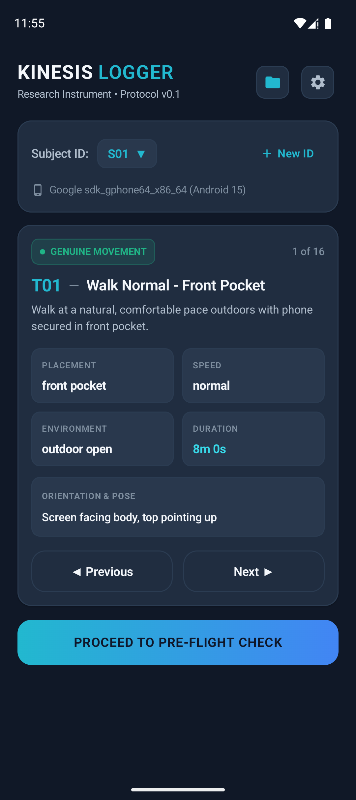
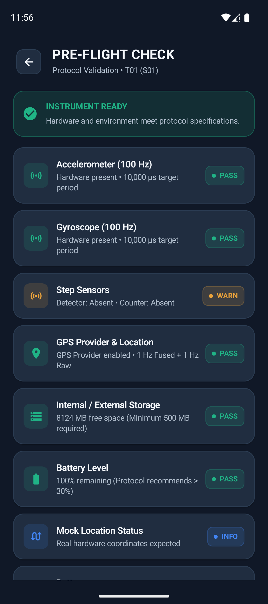

# Kinesis Logger (v0.1)

A native Android data-collection instrument built for the **Kinesis** research project (Capstone-I, by P Samuel Vijay and Arikela Sriharsh).

The app records time-aligned, un-resampled raw sensor streams (100 Hz accelerometer, 100 Hz gyroscope, step detector, step counter, 1 Hz fused GNSS, and 1 Hz raw GPS provider) across controlled genuine movement, benign non-walking, and fraud bouts.

---

## Visual Preview

<p align="center">
  
  &nbsp;&nbsp;&nbsp;&nbsp;
  
</p>

<p align="center">
  <em>Left: Task Dashboard with subject selector (S01–S06) and protocol cards. Right: Real-time sensor pre-flight validation.</em>
</p>

---

## Architecture & Technology Stack

- **Platform:** Native Android (Kotlin, Jetpack Compose, Material3)
- **Minimum SDK:** API 29 (Android 10)
- **Target SDK:** API 35 (Android 15)
- **Visual Design:** Modern fitness-tech / research instrument aesthetic (Navy background `#101827`, elevated card surfaces `#202D40`, cyan/blue accents `#22B8CF` / `#4285F4`, clean sans-serif typography, system bar insets & 48dp touch targets).
- **Subject Pool:** S01–S06 protocol pool with dynamic pseudonym registration support.
- **Concurrency & IO:** Dedicated daemon worker thread per session with thread-safe bounded queues; non-blocking sensor event handlers; atomic periodic flushing (&le; 1 s) with crash recovery.
- **Background Execution:** Foreground Service with `foregroundServiceType="location|health"` and partial wake lock.
- **Cloud Synchronization:** Secure direct upload to private AWS S3 bucket (`kinesis-data-collection-837206353876`) via temporary pre-signed S3 URLs generated by an API Gateway + AWS Lambda microservice (zero AWS credentials stored in the APK).

---

## 4-Commit Milestones

1. **Commit 1: Skeleton and Task Cards**
   - Single-module project setup (`app`), Material3 theme with research design tokens.
   - Dynamic asset loader for `assets/tasks.json` supporting all protocol tasks (T01–T16).
   - Task Dashboard with subject picker (`S01`–`S06` + custom pseudonyms), device detection, and Prev/Next navigation.
   - Initial unit tests validating schema conformity and task counts.

2. **Commit 2: Sensor Recording and Writers**
   - High-throughput non-blocking CSV writers (`accel.csv.gz`, `gyro.csv.gz`, `step_detector.csv`, `step_counter.csv`, `location.csv`, `events.csv`).
   - Strict timestamp fidelity: `t_ns` preserves hardware `SensorEvent.timestamp` and `Location.getElapsedRealtimeNanos()`.
   - Boot offset calibration (`boot_offset_ms`) and dropped-sample counters.

3. **Commit 3: Service and Crash Safety**
   - Foreground service life-cycle surviving screen lock.
   - 10 s countdown vibration, 5 s initial stillness, bout execution, 5 s terminal stillness, completion vibration.
   - WAL flush guarantees and automatic interrupted-session detection on launch.
   - Live recording HUD with timer, sensor health, and 2-second hold-to-stop safety.

4. **Commit 4: Quality Summary, Local Export & AWS S3 Cloud Sync**
   - Pre-flight diagnostic screen (sensors, GPS fix accuracy, mock location check, storage &gt; 500 MB, battery &gt; 30%).
   - Post-session quality calculator (achieved rate, median gap, GPS fix %, OS vs manual step count).
   - Manifest generator (`manifest.sha256`), `session.json` metadata, and local zip export.
   - Direct AWS S3 cloud synchronization via pre-signed PUT requests, backed by local persistent upload queue.

---

## How to Build & Run

### Prerequisites
- JDK 21 (Eclipse Temurin 21 recommended)
- Android SDK with Platform 35 and Build-Tools 34+

### Build from Terminal
```powershell
# Set JAVA_HOME
$env:JAVA_HOME = "C:\Program Files\Eclipse Adoptium\jdk-21.0.13.9-hotspot"

# Run Unit Tests
.\gradlew.bat testDebugUnitTest

# Assemble Debug APK
.\gradlew.bat assembleDebug
```
Output APK location:
`app/build/outputs/apk/debug/app-debug.apk`

---

## Known Guidelines & Restrictions
- **Data Privacy & Security:** Raw sensor data remains pseudonymous. Cloud synchronization uses time-limited pre-signed URLs from the Kinesis Lambda signer; no long-term AWS credentials or IAM secrets are embedded in the client build.
- **Battery Optimization:** Ensure battery optimization is disabled for Kinesis Logger on OEM skins (MIUI, ColorOS, OneUI) to prevent background killing during screen-off recordings.
